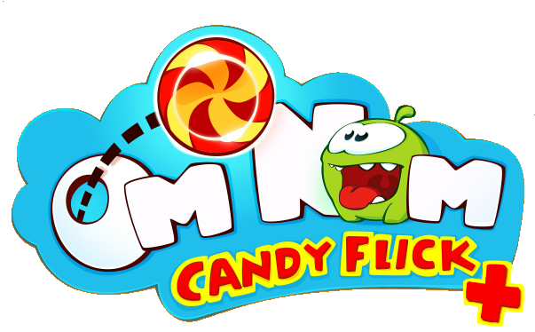

  

# Om Nom: Candy Flick +

By aidrum

Om Nom: Candy Flick + is an enhanced decompilation of the iOS game Om Nom: Candy Flick, ported to Unity 6.4, adding new modes and taking full advantage of the updated Vuforia library.

## How was this made?

Using AI, Ghidra, IL2CppDumper and ILSpy, the game's code was reconstructed and adapted for Unity 6.4, targeting Android devices.

While it is vibecoded, it has been tested properly, with big human oversight, and all behavior should be practically identical to the original game. Please open an issue if you encounter any bugs or inconsistencies. 

## Why was this made?

This was made due to the original game being locked into old iOS devices forever, wanting Android players to finally experience it, and fulfilling more potential of what was essentially a tech demo. While the game does have a 64-bit version that works on modern iOS devices, the game is bugged, and the camera output is fully black.

## Download

The latest release can be found [here](https://github.com/aidrum/candy-flick-decomp/releases/latest/) (Android only).

## Features
- **Ground detection AR mode**, so you don't need the Candy Flick image and the game will still know where Om Nom is even if he goes offscreen, similar to Pokémon GO. (Can only be used on devices that support [Google ARCore](https://play.google.com/store/apps/details?id=com.google.ar.core) and have it installed).
- **Non-AR mode** so you can play wherever you want (like cars). Can be toggled in the game's pause menu.
- **Local Multiplayer mode:** Connect to the same Wi-Fi, create a lobby and join up to 10 friends, try to score as many points as possible! Works in both Image and Ground detection mode, but Ground mode is recommended for a better experience (especially with many players).
- **Photo mode**: Place as many Nommies as you want in the world and take pictures! Only available in Ground mode, cannot be started in devices without ARCore.
- **Cut the Rope Triple Treat skins** for all Time Travel 3DS noms, and an Om Nelle model made by [MlopsFunny](https://github.com/mlopsfunny/)! (Used with permission)
- **Cut the Rope Triple Treat candies**, the original three!
- **Local achievement tracking** for the original Game Center achievements the game had!
- **Two ways to flick:** Slingshot (default) and Flick. Flick is the mode the game originally had, while slingshot was forced in an update (due to it generally being more fun). Now you can pick which one to use!

## FAQ

- **Will this get any more updates?**

  If I think of cool stuff to add, likely. If I have to fix bugs, definitely.

- **Will any other games get the same treatment?**

  A full decompilation of any other ZeptoLab iOS game is unlikely, at least if done the way I did it. It worked with Candy Flick because it's a very simple game.

- **What devices are supported?**

  Any Android device with arm64 architecture running Android 7.0 or later.

- **What devices was this tested on?**

  - Redmi Note 13 Pro 5G (Android 13): Great performance.
  - Redmi Note 8 Pro (Android 11): Great performance.
  - Samsung Galaxy A54 (Android ): Great performance.
  - LG K61: Good enough performance. (Does not support AR Ground mode)
  

- **Was AI used to generate graphics or music?**

  Nope. AI was purely used for the game code. Graphical edits and music additions were all done manually. This readme was written by hand too.

- **Why was AI used for the code?**

  We do not have the time or resources needed to do a full analysis of the iOS code manually. We playtested it for a while, even comparing it with real hardware (iPad 3 and iPhone 4S) to ensure the game was working right/accurately.
  
## Model credits
- ["Coffee Mug (School Project)"](https://sketchfab.com/3d-models/coffee-mug-school-project-5f5ccee1514c440887c072fae8e0d699) by Ole Gunnar Isager is licensed under [Creative Commons Attribution](https://creativecommons.org/licenses/by/4.0/).
- ["Lunch Plate (School Project)"](https://sketchfab.com/3d-models/lunch-plate-school-project-eef24ebe601c4e2f99da3108ddc3b09b) by Ole Gunnar Isager is licensed under [Creative Commons Attribution](https://creativecommons.org/licenses/by/4.0/).
- ["Cookie (School Project)"](https://sketchfab.com/3d-models/cookie-school-project-434b04afb75d4525ae5eb272282d736d) by Ole Gunnar Isager is licensed under [Creative Commons Attribution](https://creativecommons.org/licenses/by/4.0/).
- Om Nelle Triple Treat 3D model by [MlopsFunny](https://github.com/mlopsfunny/) on [CtR Home Discord](https://ctrhome.github.io/discord/)

All rights to original code and assets belong to ZeptoLab. No profits are made from this game.